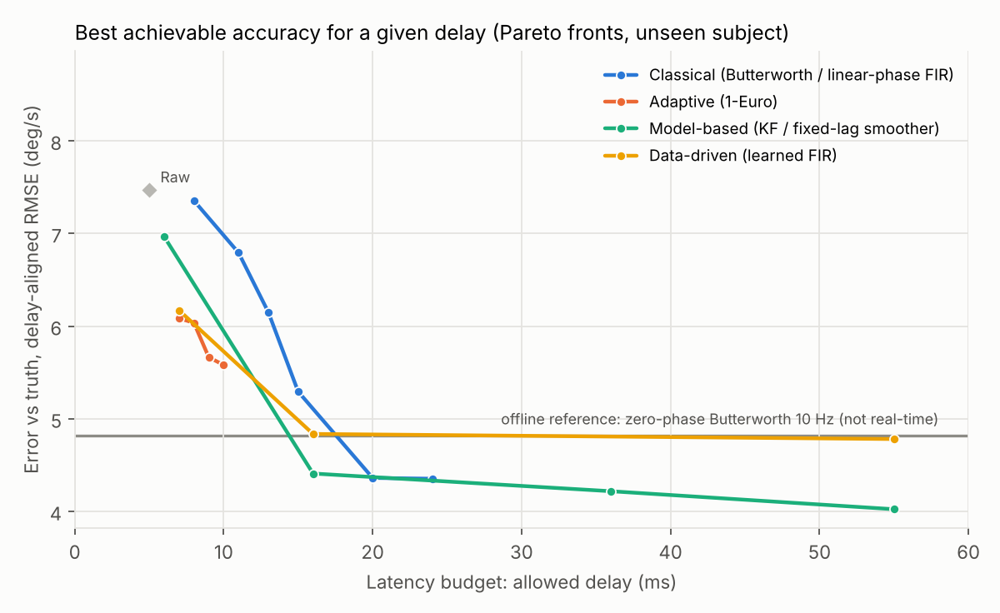
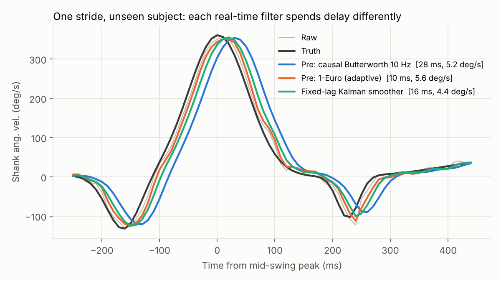
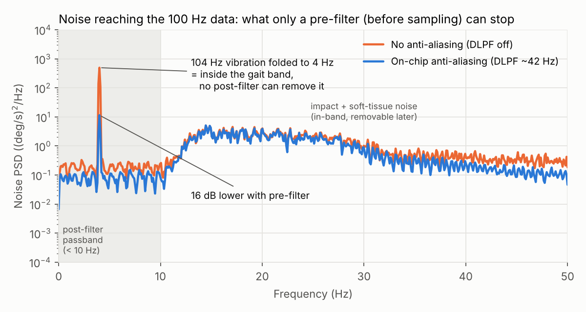

# 연구 계획서 (최종안): 지연 예산 관점에서 본 하지 IMU 필터링

> 센서 및 액추에이터 (2026-2) 기말 프로젝트
> 중간발표 원고(10분)는 [`02_midterm_script_10min.md`](02_midterm_script_10min.md)에 있다.

- 국문 제목: **지연 예산(Latency Budget) 관점에서 본 하지 IMU 필터링: 사전·사후·고정지연 필터의 정확도–지연 트레이드오프 분석**
- 영문 제목: *Filtering Lower-Limb IMU Signals on a Latency Budget: Accuracy–Delay Trade-offs of Pre-, Post-, and Fixed-Lag Filters*

---

## 0. 한 장 요약

| 항목 | 내용 |
|---|---|
| 핵심 관점 | 사전(실시간)과 사후(오프라인)는 **'허용 지연 d'라는 하나의 축의 양 끝**이다. 그 사이에 실시간으로 동작하되 d만큼 기다려 미래 샘플 몇 개를 쓰는 **고정지연 필터**가 있다. |
| 연구 질문 | 허용 지연이 주어졌을 때, 어떤 필터를 어디에 두어야 하지 IMU 신호가 가장 정확한가? |
| 측정 신호 | 정강이 시상면 각속도 (자이로 1축). 보행 이벤트(HS/TO) 검출의 표준 신호 |
| 비교 조건 | 사전(d = 0) / 결합: 고정지연(d = 10–80 ms) / 사후(d = ∞) + 센서 내부 안티앨리어싱 필터 ON/OFF |
| 필터 | 고전 선형(Butterworth/FIR), 적응형(1€ 필터), 모델 기반(칼만/고정지연 스무더/RTS). 확장: 데이터 기반 학습 필터 |
| 하드웨어 | STM32 Nucleo-F446RE (메인 DAQ + 실시간 필터), Arduino Uno (서보 액추에이터 + 저사양 비교), MPU-6050 IMU, 100 Hz 카메라 + 동기 LED |
| 참값 | 벤치 · 인체: 100 Hz 영상 + 동기 LED |
| 핵심 산출물 | 필터 계열별 **지연–정확도 곡선**, **오프라인 수준 도달 최소 지연**, 지연 예산별 필터 선택 가이드 |

---

## 1. 1차 아이디어에서 무엇이, 왜 바뀌었나

| 1차 아이디어 | 문제 | 최종안 |
|---|---|---|
| 사전 = 받으면서 필터링, 사후 = raw로 받고 나중에 필터링 | 같은 필터면 결과가 수학적으로 같다 (예비 시뮬레이션: 차이 1×10⁻⁴ deg/s) | 차이의 본질인 **미래 샘플 사용 여부 = 허용 지연**을 독립변수로 삼음 |
| 사전+사후 두 번 거치기 | 같은 필터를 두 번 쓰면 더 센 필터일 뿐. 시뮬레이션에서 같은 지연(28 ms)에 오차 5.2 → 7.0 deg/s로 악화 | **고정지연 필터**: 실시간으로 돌되 d만큼 기다려 사후처럼 앞뒤를 봄 (추정 이론의 fixed-lag smoothing). 단순 중복은 대조군으로만 유지 |
| 수업 필터(재귀 평균·MAF·LPF·KF) | 재귀 평균은 정적 신호용, MAF/1차 LPF는 Butterworth의 하위 호환 | 기준선 Butterworth + **최신 적응형 1€ 필터** + 칼만 계열(필터·고정지연·RTS). 재귀 평균은 자이로 바이어스 추정에 사용 |
| "어느 쪽이 더 나은가" | 기준·참값 없음 | 영상 참값, 지연과 정확도를 **한 쌍**으로 평가 |
| ESP32 | 요청: Arduino, STM32 | STM32 = 메인, Arduino = 액추에이터 + 저사양 비교 → **하드웨어 제약 자체가 사전 필터링의 비용**이 되는 실험 축 추가 |

그대로 남긴 것: 하지 IMU, 사전/사후/결합의 세 조건 구조, 2–3개 필터 비교.

---

## 2. 연구 배경과 주제 선정 이유 (요약)

자세한 발표 문장은 원고(`02`)에 있다.

1. **하지 IMU와 실시간성**: IMU는 보행 분석과 외골격·의족 제어에 널리 쓰인다. 정강이 자이로 각속도는 보행 이벤트 검출의 표준 신호다 [Aminian 2002; Salarian 2004]. 보행 한 주기는 약 1 s라서, 제어에서는 수십 ms의 지연도 무시할 수 없다.
2. **필터의 딜레마**: 잡음원은 착지 충격, 연부조직 흔들림, 외부 진동, 센서 잡음이다. 보행 성분은 대부분 약 10 Hz 이하다 [Winter 2009]. 인과(실시간) 저역통과 필터는 반드시 지연을 만든다. MPU-6050 데이터시트에도 DLPF 대역폭이 좁아질수록 지연이 커진다고 명시돼 있다(자이로 42 Hz → 4.8 ms, 5 Hz → 18.6 ms).
3. **사전 vs 사후의 진짜 차이**: 추정 이론의 용어로 보면 다음과 같다.
   - **filtering** (z₁…z_k → x_k): 사전
   - **fixed-lag smoothing** (z₁…z_k → x_{k−d}): 결합
   - **smoothing** (z₁…z_N → x_k): 사후
   이 셋은 허용 지연 d로 연결된다 [Rauch 1965; Kok 2017]. 별도로, 샘플링 이전의 센서 내부 필터는 앨리어싱을 막는다. 사후 처리로는 이 역할을 대체할 수 없다.
4. **선정 이유**
   - 실시간 제어와 오프라인 분석에 맞는 필터가 다를 텐데, 이를 정량적으로 비교한 근거가 부족하다.
   - 센서 시스템의 핵심 개념(샘플링·앨리어싱, 센서 내부 필터, 위상 지연)을 직접 다룬다.
   - 최신 기법(적응형 1€ 필터 [Casiez 2012], 고정지연 칼만 스무더, 엣지 MCU)을 실제 하지 신호에서 검증한다.

### 가설

| | 가설 | 예비 시뮬레이션 근거 |
|---|---|---|
| H1 | 같은 인과 필터는 MCU와 PC에서 결과가 같다 (검증용) | float32 biquad 루프 vs PC: 최대 차이 1.2×10⁻⁴ deg/s |
| H2 | 지연 ≤ 10 ms의 엄격한 실시간에서는 적응형(1€) 필터가 가장 정확하다 | 1€ 5.58 (10 ms) vs Butterworth 7.36 (8 ms) deg/s |
| H3 | 약 20 ms만 허용하면 실시간 필터도 오프라인 수준에 도달하며, 모델 기반(고정지연 칼만)이 가장 짧은 지연에서 도달한다 | 고정지연 칼만 4.41 (16 ms), Butterworth 4.36 (20 ms), 오프라인 4.82 |
| H4 | 센서 내부 안티앨리어싱 필터는 약 5 ms를 쓰는 대신, 사후로 제거할 수 없는 앨리어싱을 막는다 | AAF OFF: 104 Hz → 4 Hz 접힘, 오차 4.82 → 9.52 (2배) |
| H5 | 같은 필터의 단순 중복은 지연을 줄이지 못하고 오차만 키운다 | 같은 28 ms에서 5.22 → 7.01 |
| H6 | 필터의 연산 부담은 MCU에 따라 크게 달라, 실시간 필터 선택은 하드웨어와 함께 결정해야 한다 | 실험 3에서 실측 |

---

## 3. 비교 필터 (식 포함)

### 3.1 구성표

| 필터 계열 | 사전 (d = 0) | 결합: 고정지연 (d > 0) | 사후 (d = ∞) |
|---|---|---|---|
| 고전 선형 (기준선) | 2차 Butterworth IIR | 선형위상 FIR (지연 정확히 d) | 영위상 Butterworth (filtfilt) |
| 적응형 (최신) | 1€ 필터 | – | – |
| 모델 기반 | 칼만 필터 | 고정지연 칼만 스무더 | RTS 스무더 |
| *확장: 데이터 기반* | *학습 FIR* | *학습 FIR (정답을 d만큼 늦춤)* | *(정답 = 사후 필터)* |

- 공통 전처리: 정지 10 s 구간에서 자이로 바이어스 추정 (재귀 평균) → 모든 조건에서 빼고 시작
- 센서 단계: MPU-6050 내부 안티앨리어싱 필터 ON / OFF (MPU-6050이면 DLPF)

### 3.2 식 (T = 샘플 주기, x_k = 입력, y_k = 출력)

**바이어스 추정 (재귀 평균)**
`b_k = b_{k−1} + (x_k − b_{k−1}) / k`

**2차 Butterworth (biquad, Direct Form II Transposed)**
`y_k = b0·x_k + b1·x_{k−1} + b2·x_{k−2} − a1·y_{k−1} − a2·y_{k−2}`
- STM32에서는 CMSIS-DSP `arm_biquad_cascade_df2T_f32` 사용
- 사후형은 정방향과 역방향을 모두 통과(filtfilt)한다. 감쇠가 제곱되므로 설계 차단 주파수 = f_c / 0.802 로 보정한다 [Winter 2009].

**선형위상 FIR (고전 고정지연)**
`y_k = Σ_{i=0}^{2d} h_i·x_{k−i}`
- h가 대칭이므로 모든 주파수에서 지연이 정확히 d 샘플이다. 위상 왜곡이 없다.

**1€ 필터 [Casiez 2012]**
- `α(f) = 1 / (1 + τ/T)`, `τ = 1/(2πf)`
- `ẋ̂_k = ẋ̂_{k−1} + α(f_d)·((x_k − x_{k−1})/T − ẋ̂_{k−1})`
- `f_c,k = f_min + β·|ẋ̂_k|`
- `y_k = y_{k−1} + α(f_c,k)·(x_k − y_{k−1})`
- 빨리 변할 때는 차단 주파수를 올려 지연을 줄이고, 느릴 때는 내려 잡음을 줄인다.
- 기본값 f_d = 1 Hz는 마우스 커서용이다. 보행에서는 약 10 Hz가 필요했다(예비 시뮬레이션).

**칼만 필터 (등속 모델)**
- 상태 `x = [ω, ω̇]ᵀ`
- `F = [[1, T], [0, 1]]`, `Q = q·[[T³/3, T²/2], [T²/2, T]]`, `H = [1, 0]`, `R = r`
- 예측: `x̂_{k|k−1} = F·x̂_{k−1|k−1}`, `P_{k|k−1} = F·P·Fᵀ + Q`
- 갱신: `K = P_{k|k−1}Hᵀ(H·P_{k|k−1}Hᵀ + R)⁻¹`, `x̂_{k|k} = x̂_{k|k−1} + K(z_k − H·x̂_{k|k−1})`

**고정지연 칼만 스무더 / RTS 스무더 [Rauch 1965]**
- `C_j = P_{j|j}·Fᵀ·P_{j+1|j}⁻¹`
- `x̂_{j|k} = x̂_{j|j} + C_j·(x̂_{j+1|k} − x̂_{j+1|j})`
- 고정지연: 매 샘플 k마다 j = k−1 … k−d까지만 거꾸로 계산해 `x̂_{k−d|k}`를 출력한다. 실시간으로 동작하며 지연은 d, 연산은 O(d)다.
- RTS: j = N−1 … 0 전체를 거꾸로 계산한다 (오프라인).

**학습 FIR (확장, 데이터 기반 고정지연 위너 필터)**
`w = argmin Σ_k (y^post_{k−d} − wᵀ[x_k … x_{k−L+1}, 1])² + λ‖w‖² = (XᵀX + λI)⁻¹Xᵀy`
- 학습 피험자의 사후 필터 출력을 d만큼 늦춘 신호를 정답으로 쓴다. L = 20 (200 ms), 계수 21개.

### 3.3 공정 비교 원칙

1. 모든 조건은 **같은 raw 데이터**에 적용한다.
2. 파라미터(차단 주파수, β, q, d)를 **스윕**하고, 계열마다 지연–정확도 **파레토 전선**을 비교한다. 한 점끼리 비교하지 않는다.
3. 학습형은 **피험자 단위 교차검증**(leave-one-subject-out)을 한다.
4. 사후 기준선의 차단 주파수는 **잔차 분석**으로 정한다 [Winter 2009].

---

## 4. 하드웨어

### 4.1 구성과 역할

```
 MPU-6050 IMU (정강이) ──SPI 1 kHz──┐
 100 Hz 카메라 + 동기 LED (인체 실험) ─GPIO─┼──▶ STM32 Nucleo-F446RE ──UART 921600──▶ PC
 100 Hz 카메라 + 동기 LED ◀─GPIO─┘     · TIM2 1 µs 타임스탬프
                                             · 실시간 필터 (CMSIS-DSP), DWT 사이클 카운터
 Arduino Uno ──PWM──▶ 서보 모터 (벤치)     · raw + 필터 출력 동시 기록
      └──── 동기 GPIO (시작 펄스) ────▶ STM32 EXTI
```

| 보드 | 사양 | 역할 |
|---|---|---|
| **STM32 Nucleo-F446RE** | Cortex-M4F 180 MHz, FPU, SRAM 128 KB | 메인 DAQ, 모든 센서 공통 타임스탬프, 실시간 필터(칼만·고정지연 포함), 로깅 |
| **Arduino Uno (R3)** | ATmega328P 16 MHz, 8비트, FPU 없음, SRAM 2 KB | ① 벤치 서보 궤적 재생 (액추에이터 제어) ② 저사양 MCU에서 같은 필터의 연산 시간 비교 |

- IMU를 MPU-6050로 고른 이유: 내부 안티앨리어싱 필터와 출력 필터의 대역폭·차수를 레지스터로 설정할 수 있다. "센서 내부 사전 필터"를 실험 변수로 다루기 좋다. 구하기 어려우면 MPU-6050(DLPF_CFG) 또는 LSM6DSOX로 대체한다.
- 기록 속도: 1 kHz × 약 24 byte ≈ 24 kB/s. UART 921600 baud(바이너리 패킷)로 충분하다.
- 서보는 별도 6 V 전원을 쓰고, GND를 공통으로 묶는다(Uno 5 V 핀에 직접 연결 금지).

### 4.2 준비물

| 부품 | 수량 | 비고 |
|---|---|---|
| STM32 Nucleo-F446RE | 1 | ST-LINK 내장 (UART 가상 COM) |
| Arduino Uno R3 | 1 | |
| MPU-6050 브레이크아웃 (대안: MPU-6050) | 2 | 정강이 1 + 예비/허벅지 1 |
| 100 Hz 촬영 가능 스마트폰 + 삼각대 | 1 | 인체 실험 참값 (옆면 촬영) |
| 동기용 LED + 저항 | 1 | STM32 GPIO로 점등, 영상에 함께 촬영 |
| 서보 모터 + 6 V 전원 | 1 | 벤치 구동 |
| 링크, 베어링, 스토퍼, 코인 진동모터 | 1식 | 정강이 모형, 충격·진동원 |
| 3D 프린트 마운트, 벨크로 스트랩 | – | 센서 흔들림 최소화 |

---

## 5. 실험 설계

### 실험 1. 벤치 (참값: 영상)

- 아두이노가 서보로 정강이 모형 링크를 구동한다. 링크에 IMU를 단다.
- 조건
  - (a) 사인파 0.5 / 1 / 2 Hz, ±30°
  - (b) 보행 궤적 재생 (서보 속도 한계에 맞춰 시간 스케일 조정)
  - (c) 스토퍼 충돌 (착지 충격 모사)
  - (d) 진동모터 ON/OFF × 센서 내부 필터 ON/OFF → 앨리어싱(H4)
- 조건마다 30 s × 3회
- 참값: 링크 움직임을 100 Hz 카메라로 촬영하고 동기 LED로 IMU와 시간을 맞춘다. 영상 판독 오차(±1프레임 ≈ ±10 ms)를 한계로 명시한다.

### 실험 2. 인체 보행 (참값: 100 Hz 영상)

- 대상: 건강한 성인 3–5명 (본인 포함, 사전 동의)
- 부착: 오른쪽 정강이 전면(경골면), 측정 축을 시상면 회전축에 맞춘다. 카메라는 트레드밀 옆면에 고정하고, 시작 시 STM32가 LED를 점등해 영상–IMU 시간을 정렬한다.
- 절차: 정지 10 s (바이어스) → 발 구르기 3회 (동기 확인) → 트레드밀 느림 / 보통 / 빠름 각 2분
- 참값: 영상에서 발 접촉 프레임 = HS, 발 이탈 프레임 = TO (판독 오차 ±1프레임 ≈ ±10 ms)
- 이벤트 검출: mid-swing 피크 직후의 음의 최소점 = HS, 직전의 음의 최소점 = TO. 이 규칙을 모든 조건에 동일하게 적용한다.

### 실험 3. 임베디드 (하드웨어 비용)

- 실험 1·2에서 기록한 raw를 PC에서 각 보드로 재생(HIL)한다. 보드는 필터 출력과 1샘플 처리 시간을 돌려준다.
  - STM32: DWT 사이클 카운터로 측정
  - Uno: Timer1 또는 micros()로 측정
- 측정: µs/샘플, 메모리, 100 Hz·1 kHz 실시간 가능 여부
- 같은 입력이므로 PC 결과와 비교해 H1을 동시에 검증한다.

---

## 6. 평가 지표와 분석

| 지표 | 정의 | 의미 |
|---|---|---|
| 지연 D (ms) | 출력 y_k가 참값 x(t_k − D)와 가장 잘 맞는 D | 실시간성 |
| 지연 보정 오차 | 그때의 RMSE | 지연을 감수했을 때의 정확도 |
| 현재값 오차 | D = 0일 때의 RMSE | 지연까지 오차로 보는 관점 |
| 이벤트 시점 오차 | HS/TO 검출 − 영상 판독: 평균(= 지연, 보정 가능), 표준편차(= 지터, 보정 불가) | 응용 성능 |
| 피크 오차 (%) | mid-swing 최대 각속도 오차 | 신호 보존 |
| 연산 비용 | µs/샘플, 메모리 (Uno vs STM32) | 하드웨어 제약 |
| **오프라인 수준 도달 지연** | 오차가 사후 기준선 +5% 이내가 되는 최소 D | **핵심 단일 지표** |

- 통계: 보폭 단위로 지표를 계산한다. 조건 간 Friedman 검정 + Wilcoxon 부호순위 사후검정(Bonferroni 보정), 효과크기를 함께 보고한다.
- 그림: 파형 중첩, 잡음 PSD, **지연 예산–정확도 곡선**(핵심 그림)

---

## 7. 예비 시뮬레이션 결과 (합성 신호, 방법론 검증)

> ⚠️ **합성(가상) 보행 신호**다. 실측이 아니라 방법이 의도대로 작동하는지 확인한 것이다.
> 코드: [`sim/prelim_sim.py`](../sim/prelim_sim.py) / 전체 표: [`sim/results_table.md`](../sim/results_table.md)

설정
- 정강이 각속도 템플릿 + 착지 충격(35 Hz) + 연부조직 잡음(12–30 Hz) + 가정한 104 Hz 진동 + 백색 잡음
- 출력 100 Hz, 센서 내부 필터 약 42 Hz
- 학습형은 피험자 A로 학습하고, 모든 평가는 다른 피험자 B에서 한다.



| 필터 계열 | 지연 ≤ 10 ms | 지연 ≤ 20 ms | 오프라인 수준 도달 지연 |
|---|---|---|---|
| 고전 (Butterworth / FIR) | 7.36 (8 ms) | 4.36 (20 ms) | 20 ms |
| 적응형 (1€) | **5.58 (10 ms)** | 5.58 (10 ms) | 도달 못 함 |
| 모델 기반 (칼만 / 고정지연) | 6.97 (6 ms) | **4.41 (16 ms)** | **16 ms** |
| 확장: 학습 FIR | 6.17 (7 ms) | 4.84 (16 ms) | 16 ms |
| *참고* | Raw 7.47 (5 ms) | | 오프라인 기준선 4.82 |

단위: 지연 보정 RMSE (deg/s)





**해석**
1. **필터 종류보다 '지연 예산을 어떻게 쓰느냐'가 더 큰 변수였다.**
   - 16–20 ms를 허용하면 여러 계열이 오프라인 수준에 도달했다.
   - 10 ms 이하에서는 계열 간 차이가 컸다 (1€가 Butterworth보다 약 24% 낮음).
2. **1€ 필터는 저지연 구간 전용**이다. 지연을 더 줘도 오프라인 수준까지는 못 갔다.
3. **센서 내부 필터 OFF → 오차 2배.** 104 Hz 진동이 4 Hz로 접혀 보행 대역 안에 남았기 때문이다(16 dB 차이). 사후 처리로는 복구되지 않았다.
4. **단순 중복(사전+사후)은 손해**였다.
5. **신경망은 이득이 없었다.** 사후 필터 출력을 정답으로 학습한 소형 MLP(20-32-32-1)는 같은 데이터로 학습한 선형 학습 FIR보다 나아지지 않았다. 정답 자체가 선형 필터 출력이기 때문이다. 그래서 신경망은 엔코더 참값을 정답으로 쓸 수 있는 벤치 데이터에서만 확장으로 시도한다.

**한계**: 잡음 크기와 대역은 가정값이다. 실측 잡음이 다르면 곡선의 위치가 달라질 수 있다. 그 차이 자체를 기말 결과로 보고한다.

---

## 8. 일정 (16주 학기, 8주차 중간발표 가정)

| 주차 | 할 일 |
|---|---|
| 8 | 중간발표 |
| 9 | 하드웨어 제작: STM32 DAQ (IMU SPI, 동기 LED, 타임스탬프), 1 kHz 기록 검증 |
| 10 | 벤치 제작 (Arduino 서보 구동) + 실험 1 |
| 11 | 실시간 필터 구현 (STM32 / Uno), 실험 3 (연산 시간, H1) |
| 12 | 실험 2: 인체 보행 (3–5명) |
| 13 | 분석: 파라미터 스윕, 지연–정확도 곡선, 통계 |
| 14 | 결과 정리, 논문형 슬라이드 |
| 15 | 기말 발표 |

## 9. 위험 요소와 대응

| 위험 | 대응 |
|---|---|
| 센서 간 시간 동기 오류 → 지연 측정 오염 | 모든 센서를 STM32 한 보드의 타이머로 기록, 벤치는 GPIO 시작 펄스, 인체는 발 구르기로 확인 |
| 실측 잡음이 작아 필터 효과가 미미 | 벤치에서 진동모터·충돌로 잡음을 통제해 추가. 효과가 작다는 것 자체도 결과 |
| 영상 프레임 판독 오차 (±1프레임 ≈ ±10 ms) | 비교 대상 지연(10–20 ms)보다 작음. 한계로 명시하고 시험 촬영으로 확인 |
| 서보 속도 한계 | 보행 궤적의 시간 스케일을 늘려 재생 |
| 1€·칼만 파라미터 민감도 | 스윕해서 곡선으로 보고. 단일 튜닝값에 의존하지 않음 |
| MPU-6050 수급 | MPU-6050 / LSM6DSOX로 대체 (내부 필터 설정 가능) |

---

## 10. 참고문헌 (인용 전 원문 확인 필요)

1. Winter DA. *Biomechanics and Motor Control of Human Movement*, 4th ed. Wiley; 2009.
2. Aminian K, Najafi B, Büla C, Leyvraz PF, Robert P. Spatio-temporal parameters of gait measured by an ambulatory system using miniature gyroscopes. *J Biomech.* 2002;35(5):689–699.
3. Salarian A, et al. Gait assessment in Parkinson's disease: toward an ambulatory system for long-term monitoring. *IEEE Trans Biomed Eng.* 2004;51(8):1434–1443.
4. Casiez G, Roussel N, Vogel D. 1€ Filter: a simple speed-based low-pass filter for noisy input in interactive systems. *Proc. ACM CHI.* 2012:2527–2530.
5. Kalman RE. A new approach to linear filtering and prediction problems. *J Basic Eng.* 1960;82(1):35–45.
6. Rauch HE, Tung F, Striebel CT. Maximum likelihood estimates of linear dynamic systems. *AIAA J.* 1965;3(8):1445–1450.
7. Anderson BDO, Moore JB. *Optimal Filtering.* Prentice-Hall; 1979. (fixed-lag smoothing)
8. Kok M, Hol JD, Schön TB. Using inertial sensors for position and orientation estimation. *Found Trends Signal Process.* 2017;11(1–2):1–153.
9. Seel T, Raisch J, Schauer T. IMU-based joint angle measurement for gait analysis. *Sensors.* 2014;14(4):6891–6909.
10. Brossard M, Bonnabel S, Barrau A. Denoising IMU gyroscopes with deep learning for open-loop attitude estimation. *IEEE Robot Autom Lett.* 2020;5(3):4796–4803. (확장: 학습 기반)
11. TDK InvenSense. *MPU-6050 Datasheet.* / InvenSense. *MPU-6000 and MPU-6050 Register Map and Descriptions*, Rev. 4.2.
