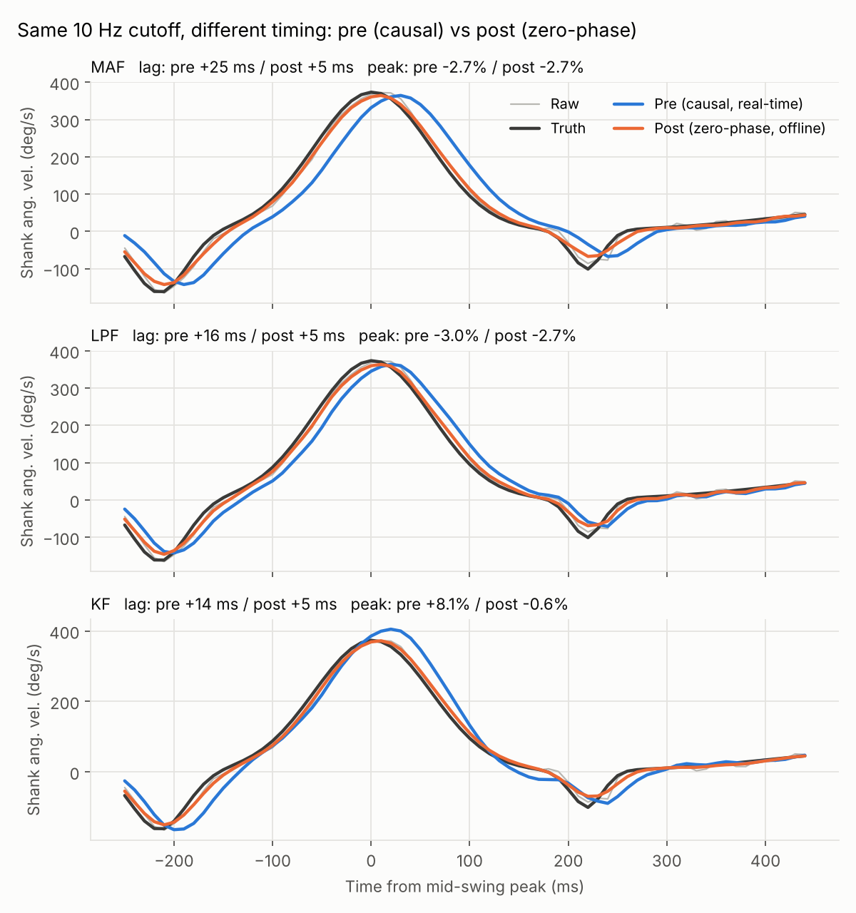
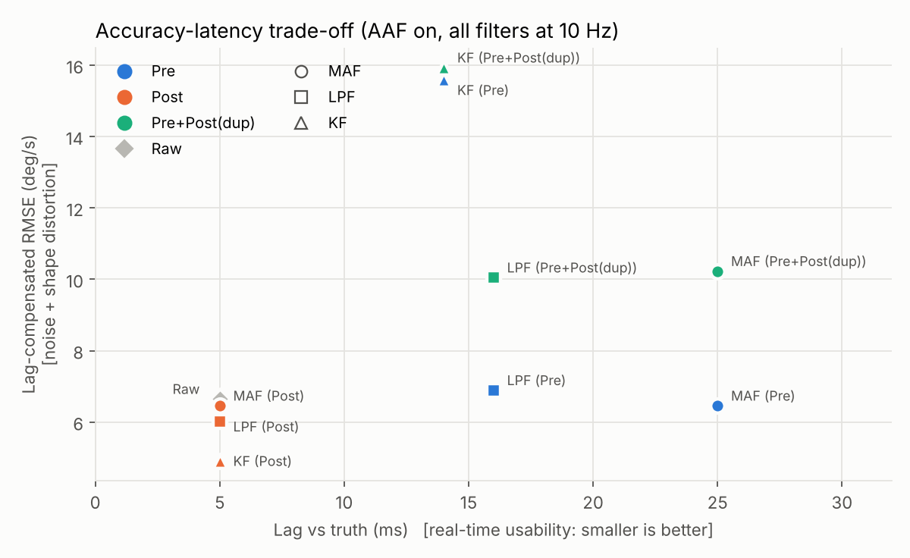

# 하지 IMU 신호의 사전·사후 필터링 비교 연구: 중간발표 준비 자료

> 센서 및 액추에이터 (2026-2) 기말 프로젝트
> 중간발표 범위: **연구 배경 → 주제 선정 이유 → 연구 진행 방법**

---

## 0. 제안 제목

- 국문: **하지 착용형 IMU 신호의 필터링 시점에 따른 정확도–지연 트레이드오프 분석: 실시간(사전) 필터링과 오프라인(사후) 필터링 비교**
- 영문: *Where to Filter? Accuracy–Latency Trade-off of Pre- vs. Post-Filtering for Lower-Limb IMU Signals in Gait Applications*

---

## 1. 아이디어 평가

### 1.1 적합성: 매우 높음

- 수업에서 배우는 필터 4가지(재귀 평균, 이동평균, 1차 저주파 통과, 칼만)를 모두 의미 있는 자리에 쓸 수 있다.
  (평균 → 이동평균 → 저주파 통과 → 칼만 순서는 김성필 『칼만 필터는 어렵지 않아』의 구성과 같다. 수업 교재라면 해당 교재의 식과 기호를 그대로 쓰는 것이 좋다.)
- 교수님 관심사인 **필터링 자체가 연구 대상**이라, 발표 내내 필터 설계와 해석을 보여줄 수 있다.
- 저가 부품(MPU-6050, ESP32, FSR)으로 한 학기 안에 끝낼 수 있는 규모다.

### 1.2 가치: 정의를 다듬으면 높음

**좋은 점**
- 실제 설계에서 마주치는 질문이다. 외골격이나 웨어러블 피드백은 실시간이 필요하고, 임상 보행 분석은 오프라인으로 해도 된다. "어디서 필터링할 것인가"는 실무 문제다.
- 한 번 측정한 raw 데이터로 여러 조건을 다시 처리할 수 있어 실험 효율이 좋다.

**그대로 진행하면 생기는 문제 (중요도 순)**

1. **같은 필터라면 사전과 사후의 결과는 수학적으로 같다.**
   MCU에서 샘플마다 `y_k = α·y_{k−1} + (1−α)·x_k`를 계산하든, 저장된 raw에 같은 식을 나중에 돌리든 출력은 같다(부동소수점 오차 수준). 예비 시뮬레이션에서 최대 차이는 4.7×10⁻⁵ deg/s였다.
   → 이대로면 결과가 "차이 없음"으로 끝나거나 첫 질문에서 설계가 무너진다. **사전과 사후의 *진짜* 차이를 독립변수로 삼아야 한다** (1.3절).
2. **"더 낫다"의 기준이 없다.** 더 매끄럽다고 더 정확한 것은 아니다. 참값(ground truth)과 정량 지표가 필요하다.
3. **조건마다 따로 측정하면 비교할 수 없다.** 걸음마다 움직임이 다르기 때문이다. 모든 조건은 **같은 데이터**에 적용해야 한다.
4. **필터마다 성격이 다르다.** 재귀 평균 필터는 *누적 평균*이라 정적 신호용이다. 보행처럼 변하는 신호에 쓰면 전체 평균으로 수렴해 파형이 사라진다. 칼만 필터는 모델 기반 추정기라서, 다른 필터와 같은 선상에서 비교하려면 설계가 따로 필요하다.
5. **사전+사후로 "두 번" 거르는 것은, 같은 필터를 두 번 쓰면 그냥 더 센 필터가 될 뿐이다.** 과평활과 지연 누적만 남는다. 두 단계의 역할을 나눠야 의미가 생긴다.
6. **필터 강도를 맞추지 않으면 비교가 임의적이 된다.** "MAF N=5 대 LPF α=0.9"는 필터 비교가 아니라 파라미터 비교다.

### 1.3 핵심 재정의: 사전 vs 사후의 진짜 차이는 "언제"가 아니라 "무엇을 아느냐"

| 구분 | 사전 (Pre, 실시간) | 사후 (Post, 오프라인) |
|---|---|---|
| 쓸 수 있는 정보 | 현재·과거 샘플만 (**인과**, causal) | 기록 전체, 미래 샘플 포함 (**비인과**) |
| 위상 지연 | 반드시 생김 | 0으로 만들 수 있음 (영위상 filtfilt, RTS 스무더) |
| 샘플링과의 관계 | 샘플링 **이전**에도 가능 (센서 내부 DLPF = 앨리어싱 방지) | 샘플링 **이후**만 가능하므로 앨리어싱은 못 고침 |
| 자원 | MCU 연산·메모리·전력 제약 | 제약 거의 없음 |
| 원본 | 버리면 복구 불가 | raw가 남아 있어 다시 튜닝 가능 |
| 용도 | 실시간 제어 (외골격, FES, 피드백) | 보행 분석, 연구 |

추정 이론의 용어로 바꾸면 다음과 같다.
- 사전 = **필터링(filtering)**: z₁…z_k로 x_k를 추정
- 사후 = **스무딩(smoothing)**: z₁…z_N 전체로 x_k를 추정

따라서 이 연구는 **"필터링 vs 스무딩"을 하지 IMU에서 정량적으로 비교하는 연구**로 정리할 수 있다. 이렇게 정의하면 학술적으로도 깔끔하다.

---

## 2. 발전시킨 연구 설계 요약

| 항목 | 내용 |
|---|---|
| 측정 신호 | **정강이(shank) 시상면 각속도 (자이로 1축)**. 보행 이벤트(HS/TO) 검출에 쓰는 표준 신호이고, 단일 채널이라 모든 필터를 공정하게 비교할 수 있다. *(확장: 허벅지 IMU를 추가해 무릎각을 칼만 융합으로 추정)* |
| 독립변수 1: 필터링 위치 | 센서 내부(DLPF) / MCU 실시간 / PC 오프라인 / 혼합 2종(단순 중복, 역할 분담) |
| 독립변수 2: 필터 종류 | MAF, 1차 LPF, KF. 각 필터는 **사전형(인과)과 사후형(비인과) 쌍**으로 구현 |
| 평균 필터의 역할 | 정지 구간의 **자이로 바이어스 추정** (모든 조건에 공통으로 쓰는 전처리) |
| 참값 | 벤치: **자기 엔코더(AS5600)** / 인체: **FSR(발바닥 압력센서)**로 보행 이벤트 시점 |
| 공정성 | 모든 필터를 **같은 −3 dB 차단 주파수**로 맞추고, 차단 주파수를 스윕해 트레이드오프 곡선 작성 |

---

## 3. 중간발표 원고

### 3.1 연구 배경

**① 하지 IMU의 확산**
- IMU(가속도계+자이로)는 작고 저렴하며 측정 장소에 제약이 없어, 광학식 모션캡처를 대체·보완하는 수단으로 보행 분석, 재활, 웨어러블 로봇(외골격·의족) 제어에 널리 쓰인다.
- 특히 정강이 자이로의 각속도 파형은 유각기 중간(mid-swing)에 큰 양의 피크를, 그 앞뒤로 toe-off(TO)와 heel strike(HS)에 해당하는 음의 피크를 보인다. 그래서 보행 이벤트 검출의 표준 신호로 쓰인다 [Aminian 2002; Salarian 2004].

**② 하지 IMU 신호에 섞이는 잡음**
- 센서 자체 잡음: 백색 잡음, 바이어스, 드리프트
- 발뒤꿈치 착지 **충격의 과도 응답**: 수십 Hz 대역
- **연부조직·스트랩 흔들림**(soft tissue artifact): 대략 10–30 Hz 대역
- **외부 진동**(트레드밀 모터 등): 샘플링 주파수의 절반(나이퀴스트)보다 높으면 **앨리어싱으로 저주파 대역에 접혀 들어온다**
- 반면 보행 운동 성분은 대부분 약 10 Hz 이하다. 보행 운동학 데이터에는 6 Hz 전후의 차단 주파수가 권장된다 [Winter 2009].

**③ 필터링의 딜레마: 잡음 제거 vs 시간 지연**
- 잡음을 줄이려면 저역통과 필터가 필요하다. 하지만 실시간(인과) 필터는 **반드시 위상 지연을 만든다.**
  - 예: 100 Hz에서 5점 이동평균은 (5−1)/2 = 2샘플, 즉 **20 ms 지연**
  - MPU-6050 데이터시트도 DLPF 대역폭이 좁을수록 지연이 커진다고 명시한다. 자이로 기준 42 Hz일 때 4.8 ms, 5 Hz일 때 18.6 ms다 [InvenSense Register Map].
- 오프라인에서는 영위상(forward-backward) 필터나 칼만 스무더로 **지연 없이** 잡음을 제거할 수 있다. 다만 미래 데이터가 필요해 실시간으로는 쓸 수 없다.
- 보행 한 주기는 약 1.0–1.2 s이고, 보행 단계 전환 시점에 맞춘 제어는 수십 ms 단위의 정확도가 필요하다. 20–30 ms 지연은 무시할 수 없는 크기다.

**④ 연구 공백**
- 실무에서는 관행적으로 처리하는 경우가 많다(센서는 DLPF 기본값, 분석은 4차 Butterworth 영위상 필터). 그러나 저가 IMU를 하지에 착용한 조건에서 **"필터를 어디에 두느냐"를 독립변수로 놓고, 같은 데이터로 정확도와 지연을 함께 정량화한 비교**는 쉽게 찾기 어렵다.
  *(발표 전에 문헌 검색으로 이 주장을 확인하고, 관련 연구가 있으면 "그 연구와의 차이점"으로 바꿔 말할 것.)*

> **발표 멘트 예시**
> "필터를 쓰면 잡음은 줄지만 신호가 늦어집니다. 그런데 이 지연은 필터를 실시간으로 돌릴 때만 생기고, 데이터를 다 모은 뒤에 거르면 없앨 수 있습니다. 그렇다면 항상 나중에 거르는 게 정답일까요? 실시간 제어에서는 그럴 수 없고, 샘플링하기 전에만 막을 수 있는 잡음도 있습니다. 이 연구는 하지 IMU에서 '언제 필터링하느냐'가 정확도와 지연에 얼마나 영향을 주는지 정량적으로 비교합니다."

### 3.2 주제 선정 이유

1. **실용적 필요**: 같은 IMU 데이터라도 용도(실시간 제어 vs 오프라인 분석)에 따라 최적의 필터링 위치가 다르다. 정량적 근거가 있는 설계 가이드가 필요하다.
2. **수업 내용과 직접 연결**: 재귀 평균, MAF, LPF, KF를 실제 하지 신호에 적용해 비교한다. 각 필터에는 인과형과 비인과형의 짝이 자연스럽게 있다.
   - MAF ↔ 중심 이동평균
   - LPF ↔ 정방향+역방향 필터(filtfilt)
   - KF ↔ RTS 스무더 [Rauch 1965]
3. **'센서' 수업의 핵심 개념을 다룬다**: 샘플링 정리와 앨리어싱, 센서 내부 디지털 필터(DLPF), 위상 지연. 신호처리를 '센서 시스템 설계' 관점에서 본다.
4. **실현 가능성**: 저가 센서(MPU-6050, ESP32, FSR, 자기 엔코더)로 구성할 수 있다. 한 번의 측정 데이터로 모든 사후 조건을 재현할 수 있다.
5. **확장성**: 결과를 외골격의 보행 단계 추정, 낙상 감지, 실시간 보행 피드백 장치 설계로 연결할 수 있다.

**연구 질문 (RQ)**
- RQ1. 같은 필터를 사전(실시간)과 사후(오프라인)에 적용하면 정확도와 지연은 어떻게 달라지는가?
- RQ2. 그 차이는 필터 종류(MAF, LPF, KF)에 따라 어떻게 달라지는가?
- RQ3. 사후 필터링으로 **대체할 수 없는** 사전 필터링의 역할은 무엇인가?
- RQ4. 사전+사후 혼합은 언제 이득이고 언제 손해인가?

**가설 (H)**
- H1. 같은 인과 필터는 MCU(사전)와 PC(사후)의 결과가 수치 오차 범위 안에서 같다. 즉 차이는 '시점'이 아니라 '인과성'에서 온다. *(검증용 가설)*
- H2. 차단 주파수가 같을 때, 사후(영위상) 필터는 사전(인과) 필터보다 지연이 작고(≈0) 보행 이벤트 시점 오차도 작다.
- H3. 사전 필터의 지연 크기는 필터 종류에 따라 다르다(MAF > LPF > KF). 다만 KF는 모델이 신호와 맞지 않으면 피크 오버슈트가 생긴다.
- H4. 샘플링 이전의 사전 필터(DLPF)가 없으면 고주파 진동이 보행 대역으로 앨리어싱되며, 이는 어떤 사후 필터로도 제거되지 않는다.
- H5. 같은 필터를 사전과 사후에 중복 적용하면 지연은 줄지 않고 피크 감쇠만 커진다. 역할을 나눈 혼합(사전 = 앨리어싱 방지, 사후 = 영위상 주필터)이 오프라인 정확도가 가장 높다.

### 3.3 연구 진행 방법

#### 3.3.1 시스템 구성

```
[IMU MPU-6050 (정강이)] ──I2C──┐
[FSR ×2 (뒤꿈치/앞꿈치)] ──ADC──┼──▶ [ESP32]
[엔코더 AS5600 (벤치 관절)] ─I2C─┘      │  ├─ raw 1 kHz 기록 (공통 타임스탬프 micros)
                                        │  └─ 사전 필터 실시간 계산 → 출력도 함께 기록
                                        ▼
                                      [PC]  사후 필터 / 지표 계산 / 통계
```

- 샘플링: raw는 **1 kHz**로 기록한다(DLPF_CFG=1, 약 188 Hz. 원신호에 가까운 기준 데이터). 웨어러블에서 흔한 **100 Hz** 조건은 이 데이터로 재현한다.
- 모든 센서를 하나의 MCU 타임스탬프로 기록하므로 **지연을 ms 단위로 측정할 수 있다.** 지연 측정에서는 시간 동기화가 가장 중요하다.

#### 3.3.2 독립변수 1: 필터링 위치

| 코드 | 조건 | 구현 |
|---|---|---|
| R | Raw | 필터 없음 (기준선) |
| A | **사전-① 센서 내부** | MPU-6050 DLPF ON(예: DLPF_CFG=3, 42 Hz) vs OFF. 샘플링 이전 단계라 앨리어싱을 막는다 |
| P1 | **사전-② MCU 실시간** | ESP32에서 샘플마다 인과 필터 계산 (원래 아이디어의 '사전 필터링') |
| P2 | **사후 PC 오프라인** | 저장된 raw에 비인과(영위상/스무더) 필터 적용 |
| H-dup | 혼합: 단순 중복 | P1 출력에 P2를 다시 적용 (대조군) |
| H-role | 혼합: 역할 분담 | A(앨리어싱 방지) + P2(주 필터) |
| (검증) | 사후-인과 | P1과 같은 인과 필터를 PC에서 적용해 P1과 일치하는지 확인 (H1) |

#### 3.3.3 독립변수 2: 필터 종류

| 필터 | 사전형 (인과) | 사후형 (비인과) | 조절 파라미터 |
|---|---|---|---|
| 이동평균 (MAF) | 후행 이동평균, 지연 (N−1)/2 샘플 | 중심 이동평균, 지연 0 | 창 길이 N |
| 1차 LPF | `y_k = α·y_{k−1} + (1−α)·x_k` | 같은 필터를 정방향+역방향 (filtfilt) | α |
| 칼만 필터 (KF) | 칼만 필터 | 칼만 필터 + **RTS 스무더** | Q/R 비 |
| 재귀 평균 | *비교 대상 아님.* 정지 10 s 구간에서 `x̄_k = ((k−1)/k)·x̄_{k−1} + (1/k)·x_k`로 자이로 바이어스를 추정하고 모든 조건에 공통 보정 | | |

- KF 모델(등속 모델): 상태 `x = [ω, ω̇]ᵀ`, `x_{k+1} = [[1, T],[0, 1]]·x_k + w_k`, 측정 `z_k = ω_k + v_k`
- **공정 비교 원칙**
  1. 모든 필터를 **같은 −3 dB 차단 주파수 f_c**로 맞춘다. f_c는 잔차 분석(residual analysis) [Winter 2009]으로 정한다. 예비 시뮬레이션에서는 10 Hz를 썼다.
  2. 영위상 필터는 정방향과 역방향을 모두 통과하면서 감쇠가 제곱된다. 그래서 **왕복 후 −3 dB가 f_c가 되도록 보정**한다.
  3. 추가로 f_c를 4–20 Hz 범위에서 스윕해 **정확도–지연 트레이드오프 곡선**을 그린다.

#### 3.3.4 실험 1: 벤치 실험 (참값이 있는 통제 실험)

- **장치**: 서보모터(또는 자유 진자)로 흔드는 링크(정강이 모형). 링크 끝에 IMU를 붙이고, 회전축에 AS5600 자기 엔코더(12비트, 약 0.088°)를 달아 참값으로 쓴다.
- **동작 조건**
  - (a) 사인파 0.5 / 1 / 2 Hz, ±30°
  - (b) 보행 유사 궤적 재생 (서보 속도 한계 안에서)
  - (c) 스토퍼 충돌: 착지 충격 모사
  - (d) 링크에 코인 진동모터 부착 ON/OFF: 고주파 진동 → **앨리어싱 시험 (H4)**
- 조건마다 30 s × 3회 반복
- 기준 각속도: 엔코더 각도를 미분한 뒤, 시험 필터들보다 훨씬 높은 차단 주파수(예: 30 Hz)로 영위상 처리해 만든다. 기준값 처리는 모든 조건에 동일하게 적용한다.

#### 3.3.5 실험 2: 인체 보행 실험 (실제 적용)

- **대상**: 건강한 성인 3–5명 (본인 포함, 사전 동의)
- **부착**: 오른쪽 정강이 전면(경골면, 연부조직이 적은 위치). 측정 축을 시상면 회전축에 맞춘다. FSR은 뒤꿈치와 제1중족골두 아래에 붙인다.
- **프로토콜**
  1. 정지 10 s: 자이로 바이어스 추정 (재귀 평균 필터)
  2. 발 구르기 3회: 동기화 확인 + 충격 신호 확인
  3. 트레드밀 보행 3속도(느림 / 보통 / 빠름, 각 2분, 속도당 약 100보 이상)
  4. (선택) 빠른 걸음 또는 가벼운 조깅: 충격이 큰 조건
- **참값**: 뒤꿈치 FSR 상승 시점 = HS, 앞꿈치 FSR 하강 시점 = TO
- **이벤트 검출 알고리즘**: mid-swing 양의 피크 직후의 음의 최소점 = HS, 직전의 음의 최소점 = TO. 이 규칙은 모든 조건에 동일하게 적용한다.

#### 3.3.6 평가 지표 (종속변수)

| 지표 | 정의 | 의미 |
|---|---|---|
| RMSE | 참값과의 평균제곱근오차 | 전체 정확도 |
| 지연 보정 RMSE | 지연만큼 이동한 뒤의 RMSE | 파형 왜곡 + 남은 잡음 |
| 지연 (ms) | 참값과의 상호상관이 최대인 시점 | 실시간성 |
| 피크 오차 (%) | mid-swing 최대 각속도의 오차 | 신호 보존 |
| 이벤트 시점 오차 (ms) | 검출된 HS/TO 시점 − FSR 시점 | 응용 성능 |
| 잡음 수준 | 정지 구간 표준편차, 고주파 잔여 파워 | 평활 성능 |
| 연산 비용 | MCU에서 1샘플 처리 시간(µs), 메모리 | 실시간 구현 부담 |

#### 3.3.7 분석 방법

- 보폭(stride) 단위로 지표를 계산하고, 조건별 평균 ± 표준편차를 보고한다.
- 같은 데이터에 모든 조건을 적용하는 반복측정 설계다. Friedman 검정을 하고, 사후 검정으로 Wilcoxon 부호순위 검정(Bonferroni 보정)을 쓴다. 효과크기도 함께 보고한다.
- 시각화: 파형 중첩, 파워 스펙트럼(PSD), 정확도–지연 산점도와 곡선

#### 3.3.8 예비 시뮬레이션 (방법론 타당성 검증)

> ⚠️ **합성(가상) 보행 신호** 결과다. 실측 결과가 아니라 **방법이 의도대로 작동하는지 확인한 것**이다. 발표에서는 반드시 "예비 시뮬레이션"이라고 밝힐 것.
> 코드: [`sim/prelim_sim.py`](../sim/prelim_sim.py), 전체 표: [`sim/results_table.md`](../sim/results_table.md)

설정: 정강이 각속도 템플릿(보폭 1.1 s ± 3%) + 착지 충격(35 Hz 감쇠진동) + 연부조직 잡음(12–30 Hz) + 가정한 104 Hz 진동 + 백색 잡음. 출력 100 Hz, 모든 필터의 −3 dB를 10 Hz 부근으로 맞췄다.






| 확인 내용 | 결과 (합성 신호) |
|---|---|
| H1: MCU식 float32 루프 vs PC 인과 필터 | 최대 차이 4.7×10⁻⁵ deg/s, 사실상 동일 |
| H2: 사전 지연 vs 사후 지연 (DLPF OFF) | MAF +20 / LPF +11 / KF +9 ms vs **모두 0 ms** |
| H2: HS 검출 시점 오차 | 사전 +6 ~ +20 ms vs 사후 약 0 ms |
| H3: KF 사전 | 지연은 가장 작지만 피크 **+8% 오버슈트** (등속 모델 불일치) |
| H4: 앨리어싱 | DLPF OFF이면 104 Hz 진동이 **4 Hz로 접혀 보행 대역에 남는다.** DLPF 42 Hz로 16 dB 감소했고, 그 대가로 약 5 ms 지연이 생겼다 |
| H5: 단순 중복 | 지연은 사전과 같고, 피크 감쇠는 약 2배(MAF −2.5% → −5.1%) |
| 종합 | KF + RTS 스무더(사후)가 가장 정확했다: 피크 −0.4%, HS 오차 −0.4 ± 2.1 ms |

시뮬레이션에서 덤으로 얻은 관찰
- 필터링이 항상 raw보다 좋은 것은 아니었다.
  - 사전(실시간) 필터는 지연 때문에 총 RMSE가 오히려 raw보다 컸다(예: MAF 35.4 vs raw 11.1 deg/s, DLPF OFF). 지연은 지연 자체가 오차다.
  - 차단 주파수를 6 Hz로 낮추면 사후 필터조차 raw보다 RMSE가 컸다(13.1–13.8 vs 11.1 deg/s, 피크 −3 ~ −7%). HS 부근의 날카로운 파형까지 깎이기 때문이다.
  - 그래서 **차단 주파수 선정(잔차 분석)이 필터 종류만큼 중요하다**는 점도 발표 포인트가 된다.
- 센서 내부 DLPF도 인과 필터이므로 공짜가 아니다(약 5 ms 지연). **DLPF 대역폭 선택 자체가 하나의 트레이드오프**다.

#### 3.3.9 일정 (16주 학기, 8주차 중간발표 가정)

| 주차 | 할 일 |
|---|---|
| 8 | 중간발표 |
| 9 | 하드웨어 제작 (IMU + FSR + ESP32), 1 kHz 기록 및 타임스탬프 검증 |
| 10 | 벤치 제작 + 벤치 실험 (엔코더 참값) |
| 11 | MCU 실시간 필터 구현, H1 검증, 처리 시간 측정 |
| 12 | 인체 보행 실험 (3–5명) |
| 13 | 분석: 파라미터 스윕, 통계 |
| 14 | 결과 정리, 논문형 슬라이드 작성 |
| 15 | 기말 발표 |

---

## 4. 중간발표 슬라이드 구성안 (10–12장)

1. **표지**: 제목, 이름, 과목
2. **연구 배경 ①**: 하지 IMU의 활용 (보행 분석, 웨어러블 로봇), 정강이 자이로 파형 그림
3. **연구 배경 ②**: IMU 잡음원 (충격, 연부조직, 진동, 센서 잡음) + 주파수 대역 그림
4. **연구 배경 ③**: 필터링의 딜레마 (잡음 vs 지연), MPU-6050 DLPF 대역폭–지연 표
5. **주제 선정 이유 + 연구 질문 + 가설**
6. **사전 vs 사후 재정의**: 1.3절의 표 + "필터링 vs 스무딩" + 위치 3단계 다이어그램 (센서 내부 → MCU → PC)
7. **비교 필터**: 3.3.3절의 표 (사전형/사후형 쌍), 평균 필터의 역할
8. **실험 장치**: 시스템 블록도, 센서 부착 위치 사진/그림
9. **실험 절차**: 벤치 실험 + 인체 실험
10. **평가 지표 & 공정 비교 원칙**: 동일 −3 dB, 스윕, 통계 방법
11. **예비 시뮬레이션**: Fig 1(지연) + Fig 2(앨리어싱). "합성 신호"라고 명시
12. **일정 & 기대 효과**: "용도별 필터링 위치 가이드라인" 제시

---

## 5. 예상 질문과 답변

**Q1. 같은 필터면 실시간으로 하든 나중에 하든 결과가 같은 것 아닌가요?**
A. 맞습니다. 그래서 그것을 H1로 직접 검증합니다. 사전과 사후의 본질적 차이는 시점이 아니라 ① 미래 샘플을 쓸 수 있는지(인과성), ② 샘플링 이전인지 이후인지, ③ 연산 자원 제약, ④ 원본 보존 여부입니다. 이 연구는 그 차이를 독립변수로 놓았습니다.

**Q2. 사후 필터가 더 정확한 건 당연하지 않나요?**
A. 정확도만 보면 그렇습니다. 하지만 실시간 제어에는 쓸 수 없습니다. 이 연구의 기여는 ① 그 차이가 *얼마나* 되는지(ms, %) 정량화하고, ② 사후 처리로는 대체할 수 없는 사전 필터의 역할(앨리어싱 방지)을 보이고, ③ 용도별 가이드를 제시하는 것입니다.

**Q3. 칼만 필터는 이동평균이나 LPF와 성격이 다르지 않나요?**
A. 그렇습니다. 그래서 같은 1채널 신호에 적용하는 선형 칼만 필터(등속 모델)로 조건을 맞췄고, 모든 필터를 같은 −3 dB 차단 주파수로 맞췄습니다. 칼만 필터는 사후형(RTS 스무더)이 이론적으로 정의되어 있어 사전/사후 비교에 오히려 가장 적합합니다. 확장 실험에서는 자이로+가속도 융합 각도 추정으로 넓힐 계획입니다.

**Q4. 필터 파라미터는 어떻게 공정하게 정했나요?**
A. 모든 필터의 −3 dB 차단 주파수를 같게 맞췄습니다. 영위상 필터는 왕복 통과를 보정했습니다. 한 값에 의존하지 않도록 차단 주파수를 스윕해 곡선으로도 비교합니다.

**Q5. 참값은 무엇인가요?**
A. 벤치에서는 회전축의 자기 엔코더, 인체 실험에서는 FSR로 측정한 보행 이벤트 시점입니다. 모든 센서를 한 MCU의 타임스탬프로 기록해 지연을 ms 단위로 비교할 수 있습니다.

**Q6. 피험자 수가 적은데 일반화할 수 있나요?**
A. 이 연구는 신호처리 방법을 비교하는 연구이고, 같은 데이터에 모든 조건을 적용합니다. 그래서 피험자 간 차이가 조건 비교를 흐리지 않습니다. 보폭 단위로 수백 개의 표본을 얻습니다. 피험자 수가 적다는 한계는 결론에서 밝히겠습니다.

**Q7. 왜 정강이 자이로인가요?**
A. 보행 이벤트 검출에 가장 많이 쓰는 신호이고, 지연이 응용 성능(이벤트 시점)으로 바로 이어지기 때문입니다. 단일 채널이라 필터 비교도 공정합니다.

**Q8. 재귀 평균 필터는 왜 비교에서 뺐나요?**
A. 재귀 평균은 누적 평균이라, 변하는 보행 신호에 쓰면 전체 평균으로 수렴해 파형이 사라집니다. 대신 이 필터가 원래 잘하는 일, 즉 정지 구간에서 자이로 바이어스를 추정하는 데 씁니다.

**Q9. 차단 주파수 10 Hz의 근거는?**
A. 예비 시뮬레이션에서 쓴 값입니다. 실제 실험에서는 잔차 분석으로 정합니다. 각속도는 각도보다 고주파 성분이 많아서, 위치 데이터에 권장되는 6 Hz보다 높게 잡아야 할 가능성이 큽니다.

---

## 6. 준비물 (예시)

| 부품 | 수량 | 용도 |
|---|---|---|
| MPU-6050 (GY-521) | 2 | 정강이 1개 + 예비/허벅지 1개 |
| ESP32 DevKit | 1 | 1 kHz 기록 + 실시간 필터 (FPU 내장. Arduino Uno는 연산과 전송 속도가 빠듯함) |
| FSR-402 + 10 kΩ 저항 | 2 | 뒤꿈치, 앞꿈치 (HS/TO 참값) |
| AS5600 자기 엔코더 + 자석 | 1 | 벤치 회전축 참값 |
| 서보 MG996R(또는 진자), 링크, 베어링 | 1식 | 벤치 |
| 코인 진동모터 | 1 | 앨리어싱 시험용 진동원 |
| 벨크로 스트랩, 3D 프린트 마운트 | – | 센서 고정 (흔들림 최소화) |
| (선택) 힌지형 무릎 보호대 + AS5600 | 1 | 확장: 무릎각 참값 |

- 기록 속도: 1 kHz × 약 20 byte ≈ 20 kB/s. 시리얼 921600 baud(바이너리) 또는 SD 카드를 권장한다.
- MPU-6050 DLPF 설정 레지스터: `CONFIG (0x1A)`의 `DLPF_CFG` 비트. 자이로 대역폭/지연은 256 Hz/0.98 ms, 188/1.9, 98/2.8, 42/4.8, 20/8.3, 10/13.4, 5 Hz/18.6 ms다. **사용하는 칩의 데이터시트로 다시 확인할 것.**

---

## 7. 참고문헌 (인용 전 원문 확인 필요)

1. Winter DA. *Biomechanics and Motor Control of Human Movement*, 4th ed. Wiley; 2009. (잔차 분석, 영위상 Butterworth, 보행 운동학 차단 주파수)
2. Aminian K, Najafi B, Büla C, Leyvraz PF, Robert P. Spatio-temporal parameters of gait measured by an ambulatory system using miniature gyroscopes. *J Biomech.* 2002;35(5):689–699.
3. Salarian A, et al. Gait assessment in Parkinson's disease: toward an ambulatory system for long-term monitoring. *IEEE Trans Biomed Eng.* 2004;51(8):1434–1443.
4. Seel T, Raisch J, Schauer T. IMU-based joint angle measurement for gait analysis. *Sensors.* 2014;14(4):6891–6909.
5. Kok M, Hol JD, Schön TB. Using inertial sensors for position and orientation estimation. *Found Trends Signal Process.* 2017;11(1–2):1–153. (IMU 추정에서 filtering vs smoothing)
6. Kalman RE. A new approach to linear filtering and prediction problems. *J Basic Eng.* 1960;82(1):35–45.
7. Rauch HE, Tung F, Striebel CT. Maximum likelihood estimates of linear dynamic systems. *AIAA J.* 1965;3(8):1445–1450. (RTS 스무더)
8. Gustafsson F. Determining the initial states in forward-backward filtering. *IEEE Trans Signal Process.* 1996;44(4):988–992. (filtfilt)
9. InvenSense. *MPU-6000 and MPU-6050 Register Map and Descriptions*, Rev. 4.2. (DLPF_CFG)
10. 김성필. 『칼만 필터는 어렵지 않아』. 한빛아카데미.
