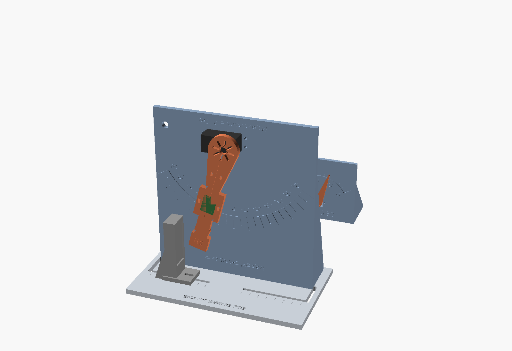
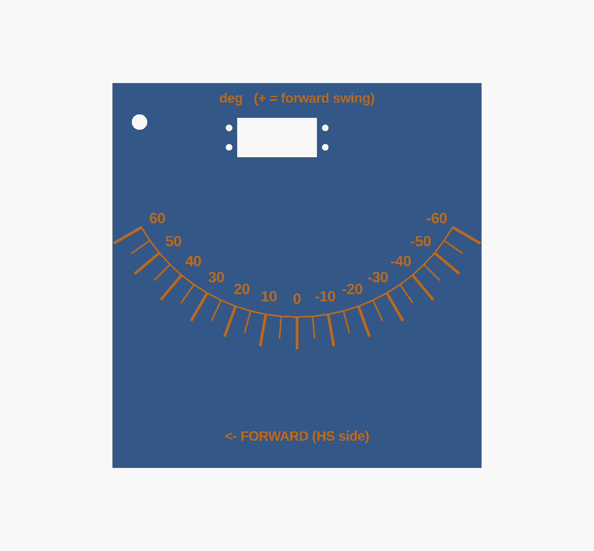
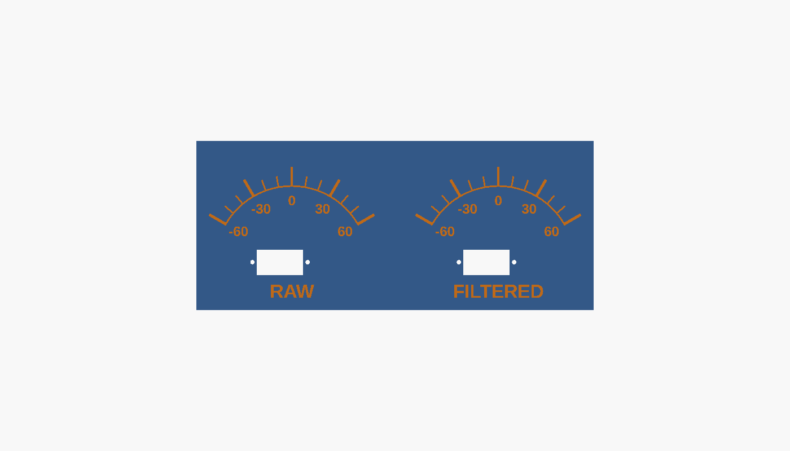
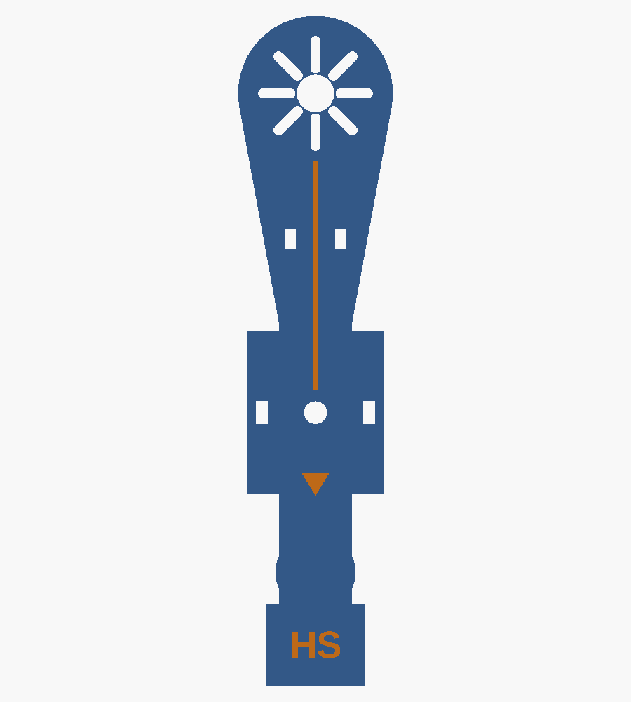

# 벤치 리그 하드웨어: 정강이 모사 스윙 리그와 바늘 표시기



## 목적

리그는 사람 없이도 같은 동작을 수십 번 반복하며, 필터가 신호의 흔들림과 지연을 어떻게 바꾸는지 보여 준다.

- **반복 가능한 입력**: 서보가 정강이를 닮은 암을 보행 패턴으로 흔든다. 패턴은 입각기에 후퇴하다 유각기에 빠르게 전진하는 형태이고, 매 보폭이 같다.
- **HS 충격**: 암 끝이 스토퍼에 부딪혀 뒤꿈치 닿기와 비슷한 충격 파형을 만든다.
- **흔들림과 앨리어싱**: 암 뒷면의 코인 진동모터가 고주파 진동을 준다. 센서 내부 AAF를 끄면 이 진동이 저주파로 접혀 들어오는 모습이 그래프와 바늘에 그대로 보인다.
- **참값**: Arduino가 명령한 HS·TO 시점을 펄스로 STM32에 보내, 같은 시계로 기록한다.
- **눈으로 확인**:
  - 타워 앞면의 각도 눈금으로 암 각도를 읽는다.
  - 바늘 표시기 두 개(RAW / FILTERED)로 "흔들리지만 빠름"과 "부드럽지만 늦음"을 비교한다.
  - PC 화면(`tools/live_view.py`)으로 수치를 본다.

| 타워 앞면 (각도 눈금) | 바늘 표시기 | 암 (윗면) |
|---|---|---|
|  |  |  |

## 1. 3D 출력 부품

치수는 모두 `rig.scad` 맨 위의 변수로 바꿀 수 있다. ★ 표시 변수는 가진 부품을 캘리퍼로 재서 맞춘 뒤 STL을 다시 뽑는다. 다시 뽑는 명령은 `openscad -D 'PART="tower"' -o stl/tower.stl rig.scad`이다.

| 부품 | 파일 | 크기 (mm) | 부피 | 출력 방향 | 권장 설정 | 예상 시간* |
|---|---|---|---:|---|---|---:|
| 타워 (서보 고정 + 눈금판) | `stl/tower.stl` | 190×198×46 | 325 cm³ | 앞면(눈금)을 베드에 | PLA, 0.2 mm (급하면 0.28), 벽 3, 채움 15–20 % | 7–9 h |
| 베이스 | `stl/base.stl` | 210×124×6 | 151 cm³ | 그대로 | 벽 3, 채움 20 % | 3–4 h |
| 암 (정강이 모사) | `stl/arm.stl` | 34×147×6 | 18 cm³ | 그대로 (혼 자리가 베드) | 벽 4, 채움 40 % 이상 (충격) | 1 h |
| 스토퍼 ×2 | `stl/stopper.stl` | 46×28×75 | 33 cm³ | 발을 베드에 | 벽 3, 채움 30 % | 1.5 h ×2 |
| 바늘 표시기 판 | `stl/display.stl` | 200×85×50 | 147 cm³ | 앞면을 베드에 | 벽 3, 채움 15 % | 3–4 h |
| 바늘 ×2 | `stl/needle.stl` | 11×50×2 | 0.6 cm³ | 그대로 | 0.12–0.16 mm | 10 min ×2 |

\* 예상 시간은 부피로 어림한 값이므로 슬라이서에서 확인한다. 전체 PLA는 약 300 g이다.

- 베드는 220×220 mm 이상이어야 한다. 타워와 베이스는 대각선으로 놓지 않아도 들어간다.
- 눈금과 글자는 0.8 mm 음각이다. 앞면이 베드에 닿게 출력하면 매끈하게 나온다. 음각을 유성펜으로 메우면 발표장에서도 잘 보인다.
- 출력 순서: 타워를 D1 밤에 출력하고, 베이스·암·스토퍼는 D2 오전에 출력한다. 표시기는 데모용이라 D4–D5에 출력해도 된다.

## 2. 구매·준비물 (BOM)

| 구분 | 품목 | 수량 | 비고 |
|---|---|---:|---|
| MCU | Arduino Uno (또는 호환) | 1 | 리그 구동: 서보, 진동모터, LED, 이벤트 펄스 |
| MCU | STM32 Nucleo-F446RE | 1 | 센서와 실시간 필터, 바늘 서보 |
| 센서 | MPU-6050 (GY-521 보드) | 1 (+예비 1) | 3.3 V로 구동 |
| 액추에이터 | 표준형 서보, **금속 기어 권장** (MG996R 크기 계열) | 1 | 스토퍼 충돌을 반복하므로 플라스틱 기어는 마모됨 |
| 액추에이터 | 마이크로 서보 (SG90 계열) | 2 | 바늘 |
| 액추에이터 | 코인 진동모터 Ø10 mm, 3 V | 1 | 암 뒷면 포켓 |
| 구동 | N-MOSFET (로직 레벨, 예: AO3400 / IRLZ44N) 또는 2N2222 + 1 kΩ | 1 | 진동모터 스위칭 |
| 구동 | 다이오드 1N4148 (또는 1N4007) | 1 | 진동모터 역기전력 |
| 표시 | 고휘도 LED 5 mm + 220 Ω | 1 | 카메라 동기용, 긴 선으로 카메라 화면 안에 둠 |
| 신호 | 저항 2.0 kΩ + 3.3 kΩ | 1조 | Arduino 5 V 펄스를 STM32 3.3 V로 분압 |
| 입력 | 택트 스위치 | 2 | 리그 프리셋, 바늘 필터 선택 |
| 전원 | 5–6 V 3 A 어댑터 (서보 전용) + 470 µF 전해 콘덴서 | 1 | **서보는 Arduino 5 V 핀에서 전원을 받지 않는다** |
| 기구 | M3×12 볼트+너트 ×8, M3×8 ×4, 서보 혼 나사(M2 자가태핑) ×4, 고무발 ×4 | | 타워–베이스, 서보, 스토퍼 |
| 기구 | 고무 패드 (지우개 조각 / 실리콘 범퍼) 10×20 mm | 2 | 스토퍼 충격면 |
| 기구 | 양면테이프(얇은 것), 케이블타이 2.5 mm 폭, C-클램프 2 | | IMU 고정, 책상 고정 |
| 배선 | 브레드보드, 점퍼선, 4심 연장선 1 m (IMU), USB 연장선 3–5 m | | 사람 보행 실험 때 USB 연장 |
| 촬영 | 100 fps 이상 카메라(스마트폰 슬로모션 가능) + 삼각대 + 조명 | | 120 fps면 분석 때 fps=120 지정 |
| 사람 실험 | 벨크로 스트랩 (정강이), 보조 배터리는 선택 | | |

## 3. 조립

1. **서보를 타워에 고정한다.** 뒤에서 몸체를 끼워 플랜지를 타워 뒷면 보강틀에 M3로 고정한다. 출력축이 앞(눈금 쪽)으로 나오고, 축은 눈금 중심에 온다. 축이 중심에서 벗어나면 `SV_SHAFT_OFF`를 실측값으로 고친다.
2. **서보 0°를 맞춘다.** 혼을 끼우기 전에 Arduino를 연결하고 `c1500` 명령을 보내 서보를 중립에 둔다. 그 상태에서 원형 혼을 암 뒷면의 혼 자리에 끼우고 M2 나사 2–4개로 방사형 슬롯에 고정한다. 그다음 혼을 축에 꽂되, 암이 눈금 0°(수직 아래)에 최대한 가깝게 꽂는다. 남는 오차는 `c` 명령으로 맞춘다.
3. **IMU를 붙인다.** GY-521을 암 앞면 포켓에 넣는다. 보드의 X 화살표가 암 끝(아래)을 향하게 하고, 부품면이 앞을 보게 한다. 얇은 양면테이프와 케이블타이 두 줄로 고정하고, 핀 헤더 쪽은 포켓 옆 홈으로 뺀다. 이 방향이면 펌웨어 기본값(시상면 = gz)과 맞는다.
4. **진동모터를 붙인다.** 암 뒷면 포켓에 진동모터를 붙이고 선은 홈을 따라 위로 뺀다. IMU 선과 함께 축 근처 케이블타이 구멍에 묶어, 암이 움직일 때 선이 당기지 않을 만큼 여유를 둔다.
5. **타워를 베이스에 조인다.** 뒤 발 2곳을 M3로 조이고, 베이스는 책상에 C-클램프로 고정한다. 리그가 흔들리면 그 진동도 측정에 들어간다.
6. **스토퍼를 단다.** 앞쪽 슬롯(+x)에 고무 패드를 붙인 스토퍼를 단다. 암이 +20° 근처에서 패드에 닿도록 위치를 잡고, 슬롯 옆 눈금(10 mm 간격)에 위치를 기록한다.
7. **바늘 표시기를 조립한다.** 마이크로 서보 2개를 끼우고, 1자 혼을 바늘 뒷면 자리에 붙인다. 서보를 1500 µs(0°)로 둔 채 바늘이 0을 가리키게 꽂는다.

## 4. 배선

```
                 외부 5–6 V 3 A ──┬── 표준 서보 V+ ──┬── 마이크로 서보 ×2 V+
                                  │  (470 µF)        │
                 GND ─────────────┴──────────────────┴── Arduino GND ── STM32 GND  (모두 공통)

 Arduino Uno                                   STM32 Nucleo-F446RE
  D9  ── 표준 서보 신호                           D15/PB8 (SCL) ── MPU-6050 SCL
  D5  ── MOSFET 게이트 (진동모터)                 D14/PB9 (SDA) ── MPU-6050 SDA
  D6  ── 220 Ω ── 동기 LED ── GND               D2 /PA10      ── MPU-6050 INT
  D7  ── 2.0 kΩ ──┬── STM32 D3 (PB3)            3V3 / GND     ── MPU-6050 VCC / GND,  AD0 ── GND
                  └ 3.3 kΩ ── GND               D5 /PB4       ── 바늘 RAW 신호
  D2  ── 버튼 ── GND (프리셋 순환)               D6 /PB10      ── 바늘 FILTERED 신호
  USB ── PC (115200)                           D7 /PA8       ── 버튼 ── GND (바늘 필터 순환)
                                               USB(ST-LINK) ── PC (921600)

 진동모터:  +3.3 V(또는 5 V, 저항 직렬) ── 모터 ── MOSFET 드레인,  소스 ── GND,  모터 양단에 다이오드(캐소드가 + 쪽)
```

- I²C 선은 1 m 이내로 한다. 사람 실험 때 선이 길어 I²C 오류(`# i2c error`)가 나면 펌웨어의 `Wire.setClock(400000)`을 `100000`으로 낮춘다.
- 이벤트 펄스 폭으로 종류를 구분한다: 3 ms = HS, 9 ms = TO, 30 ms = SYNC. STM32 인터럽트가 상승·하강 시각을 µs 단위로 잰다.

## 5. 보정 (D2, 약 1시간)

| 항목 | 방법 | 기록할 값 |
|---|---|---|
| 서보 중심 | 리그 `m0`, `p0` → 타워 눈금 0°에 오도록 `c1480` 식으로 조정 | `servoCenterUs` |
| 서보 각도 이득 | `p30`, `p-30`을 보내고 눈금을 읽어 `g`를 조정 (실제 30°가 되게) | `servoUsPerDeg` |
| 자이로 부호 | `p0` → `p30`일 때 live_view의 각속도가 + 피크인지 확인. 아니면 `W_SIGN = -1` 후 다시 업로드 | `W_SIGN` |
| 기울기 부호 | 암을 앞으로 기울였을 때 tilt가 +인지 확인. 아니면 `TILT_SIGN = -1` | `TILT_SIGN` |
| 서보 지연 | 리그 보행(`P2`)을 100 fps로 촬영 → HS LED 켜진 프레임과 암이 스토퍼에 닿는 프레임 차이 | 지연(ms) (분석은 자동 보정, 보고용) |
| 진동 주파수 | `P1` + STM32 `r1000`, `a0` → `analyze.py static`의 주 피크(Hz) | f_vib |
| 앨리어싱 데모 조건 | 100 Hz 출력에서 접힌 주파수 = \|f_vib − 100·round(f_vib/100)\|. 2–5 Hz가 되도록 진동 PWM(`v`)을 조정 | `v` 값, 접힌 주파수 |

## 6. 안전·주의

- 서보는 전원을 켜는 순간 튈 수 있다. 처음에는 암을 끼우지 않고 각도 범위부터 확인한다. 펌웨어가 ±60°로 제한한다.
- 스토퍼 충돌 실험은 금속 기어 서보로 하고, 한 번에 2분 이내로 돌린다. 서보가 뜨거워지면 쉬게 한다.
- 데모 중 진동모터를 오래 켜 두면 포켓 테이프가 풀릴 수 있다. 시작 전에 다시 확인한다.
